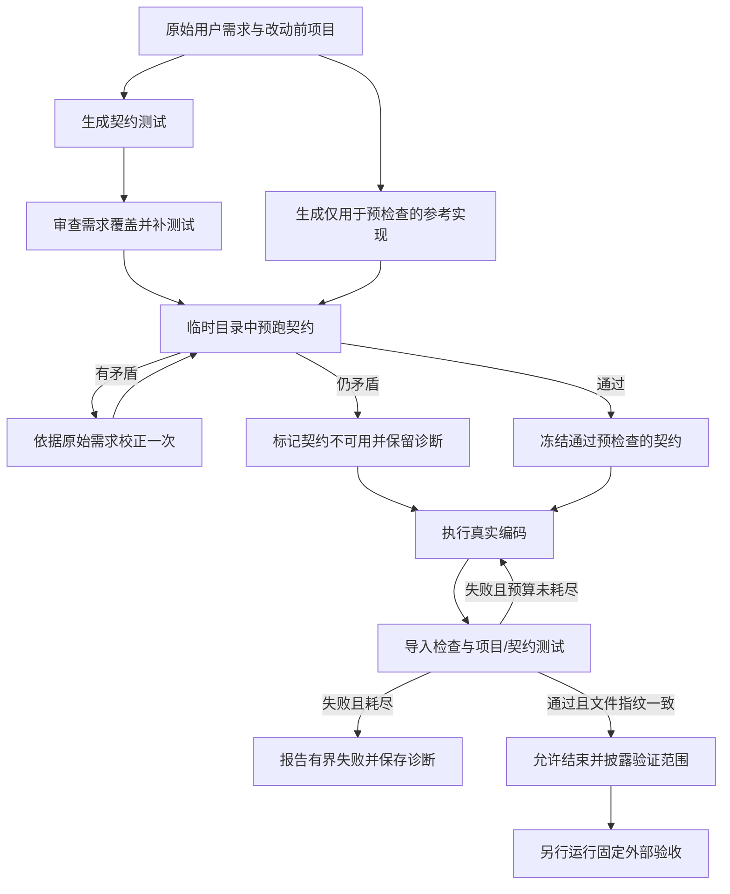

# Ibex 修复记录与面试讲述

日期：2026-11-14（北京时间）。本文记录实际问题、方案、验证与限制，完成过程中持续更新。迁移后最新机制回归为 Windows 148 passed / 1 skipped、Linux 149 passed；模型任务质量见完整实测结果，不能与机制测试混用。

## 背景：服务可运行不等于开发任务成功

上一轮 Windows/Linux 服务回归各 117 项通过，真实飞书接入、队列、Worker、Outbox 也通过。但固定开发任务集 6 题 × 2 次只完成 1/12（8.3%）：一项边界断言失败就算整次失败。原始数据保留在 `eval/results/2026-11-13-objective-v1.json`。

## 修复顺序与方案

| 顺序 | 问题及证据 | 原因 | 本轮解决方案 | 验证状态 |
| --- | --- | --- | --- | --- |
| 1 | 非有限金额触发 InvalidOperation；bool 被当作整数；失败后状态要求被遗漏 | 模型自建测试偏向正常样例，没有逐项验收输入契约 | 修改前从原始需求单独生成契约测试；与实现分开生成；测试保留在控制端，每次验证重新注入沙箱；失败不能直接报告完成 | 已实现，机制回归通过 |
| 2 | `confloat(finite=True)` 导致 Pydantic 模块导入失败 | 按记忆调用 API，没有核对安装版本 | 提供沙箱内依赖签名检查工具；验证时导入改动模块，再跑契约和项目测试 | 已实现，安装版本签名与导入失败测试通过 |
| 3 | edit_file 重复失败、三次图上限、一次 300 秒超时 | 精确匹配编辑缺乏恢复流程，测试失败没有约束最终结果 | 重复相同失败调用受限；提供完整文件读取及 SHA256 条件替换；结束前验证指纹，修改后旧测试结果失效；修复轮次与工具次数有上限 | 已实现，旧哈希拒绝、失败阻断和真实图路由测试通过 |
| 4 | 超时/图异常样本没有完整诊断产物 | 在成功返回后才取代码，异常直接释放沙箱 | 异常释放前尽力保存目标文件、契约和有界工具轨迹；保持原错误为主错误 | 已实现，异常先采集后清理测试通过 |
| 5 | 第一轮修复试跑仍然达到图上限，轨迹显示反复 `ModuleNotFoundError: app` | pytest 控制台入口未保证项目进入 sys.path；命令退出码只出现在 ToolMessage 文本中，审计错误地计为成功 | 沙箱 execute 明确设置 PYTHONPATH；识别命令非零退出标记为失败；相同失败调用受限，实际修改后允许重新测试 | 机制回归通过；不保证消除所有图上限失败 |
| 6 | 第二次试跑内部测试通过，但外部非法输入断言仍失败 | 内部测试覆盖了负数、Infinity，却遗漏无法解析的数值字符串；测试作者与实现模型共享盲点 | 冻结契约前追加独立的需求覆盖审查，只允许补测试；明确检查不同非法输入等价类，不用“测了负数”替代“测了非数值字符串” | 审查流程已实现；边界遗漏尚未彻底解决 |
| 7 | 第三次试跑内部舍入测试把 `0.0049 + 0.0050 + 0.0051` 按两位 ROUND_HALF_UP 错写成 0.01（实际 0.02） | 生成测试本身也会幻觉，错误门禁会诱导实现偏离需求 | 在候选实现生成前，用只看原始需求的参考实现隔离预跑契约；最多一次矛盾校正，不允许减少测试数量；参考代码不注入候选工作区。曾采用“仍矛盾则阻塞”，最终被第 9 项方案替代 | 预检查机制回归通过；参考实现不是真值 |
| 8 | 复测中参考源码 JSON 解析失败 | 实际返回把 Python 源码中的换行直接放进 JSON 字符串，标准 strict JSON 解码拒绝 | 专用解码器仅放宽字符串控制字符限制，继续要求 JSON 对象、路径白名单、类型与 AST 检查；不使用 eval；其他语法错误记录为契约不可用 | 原始换行场景回归通过；不能修复所有模型 JSON 错误 |
| 9 | 强制预检查阻塞了多个尚未编码的任务 | 生成参考实现不是真值，要求两份不可靠模型输出完全一致会降低可用性 | 撤回“争议契约阻塞整任务”：未通过预检查的契约不进入强制断言，记录 project_only；项目测试仍必须通过，最终回复必须说明完整需求未验证 | 已实现，范围披露和项目失败阻断测试通过 |
| 10 | 多个试次在约 2 秒内 BadRequestError，直接模型探测返回 Arrearage | 模型账号欠费或状态异常，不能归因于代码能力 | 保存允许名单中的账号错误码，停止剩余付费调用，记录 planned_trials 和 incomplete；不保存可能含敏感信息的原始异常文本 | 已实现，用户恢复账号后最小请求成功，已重新复测 |
| 11 | 账号再次中断，直接从头重跑可能抹去失败或重复消耗 | 原运行器只能新开整轮，没有保留前缀的续跑入口 | 新增显式续跑，校验任务/评分器/配置与样本顺序，只执行未执行部分；旧失败保留在分母，旧文件不覆盖 | 6 项续跑回归通过；整套 Windows/Linux 各 143 项通过 |
| 12 | Docker 管理代理异常时生命周期命令可能一直等待，HTTP 探活仍正常 | 创建/清理命令未设超时，存活检查未访问 Docker | 生命周期命令默认 60 秒；Linux 超时/取消回收子进程；新增有鉴权的沙箱依赖就绪接口与 Compose 健康启动条件 | 真实子进程超时/取消测试、Docker 失败 503 测试及真实沙箱生命周期通过 |

## 面试回答框架

“我把验证分成服务正确性和任务质量两层。服务回归通过后，我用固定任务及独立验收发现只有 1/12 完成，问题集中在边界校验、依赖兼容和工具循环。因此没有先堆更多 Agent 角色，而是补需求到测试的闭环：从原始需求独立起草内部契约测试、检查真实依赖签名、修改后强制验证，并限制无效循环。最后保留原基线，用相同外部验收再跑，并加入新题检查泛化。”

这里的“独立”指测试生成步骤不看待评实现，不代表使用不同厂商模型。内部测试可能和实现共享模型偏差，不能代替外部验收。被争议测试误拦后，我根据实测调整了设计，而不是不断增加判断层。

## 核心流程（可画在面试白板上）

参考实现和契约预检查在编码开始前完成，候选 Agent 不会拿到参考源码；临时目录结束即删除。只有预检查通过的契约作为额外断言；未通过时仍运行项目测试，并明确报告 `project_only`，不能冒充完整需求验证。外部验收模块不注入工作区，只在 Agent 执行结束后运行。

## 常见追问与回答要点

**为什么不用一句更长的提示词解决？**

提示词负责告诉模型怎么做，机制负责检查是否做到了。这里增加了实际退出码判断、内容指纹、重复失败预算和图路由。即使模型回复“完成”，失败的测试仍会触发纠正轮次。提示词和机制各自有作用。

**如何发现循环的具体原因？**

在异常释放沙箱前保存代码与工具轨迹。第一次试跑显示 pytest 找不到 `app`，模型误改 conftest 并重试；这将模糊的“模型不稳定”定位成导入路径与工具错误识别问题。随后明确 PYTHONPATH，并把命令非零退出标记为失败。

**SHA256 用来做什么？**

用于检查文件版本，不是权限或安全凭证。Agent 先读取文件，替换时提交读取版本的哈希；内容已经变了就拒绝覆盖。验证结束也保存 app/tests 下 Python 文件指纹，继续修改后必须重新测试。并发互斥仍由现有工作区锁负责。

**测试也错了怎么办？**

实际遇到过：生成测试把 0.015 按两位 ROUND_HALF_UP 错写为 0.01，正确应为 0.02。参考预检查能发现部分矛盾，但参考实现也可能错。我先试过严格阻塞，实测发现过度阻塞；最终改为不采信有争议的生成契约，仍强制执行项目测试，并披露验证范围。没有修改外部评测答案或门槛。参考与测试共享模型，仍可能一起犯错，所以保留外部验收。

**如何避免刷评测分数？**

旧任务定义和外部验收命令保持不变，原始失败基线不覆盖；新增三类不同任务单独统计；所有超时和失败都计入分母。开发试跑不混入正式复测，也不只挑最好一次。

**有什么代价？**

每个编码任务新增契约起草、覆盖审查、参考生成等模型调用，矛盾校正还会增加一次调用；因此成本和延迟可能上升。本轮记录内部调用 usage，不将它们混同于原有主 Agent token 计数。当前方案先验证正确性收益，没有宣称成本降低。

这些额外调用的 usage 目前主要保存在评测轨迹中，原主 Agent token 累计和成本看板不能当作它们的完整账单统计。失败在契约发布前时，部分阶段 usage 可能缺失，不能补零推算成本。

## 必须诚实说明的边界

- 不能说“加了测试门禁就保证代码正确”。它只能验证已有断言；遗漏需求、错误预期和恶意代码仍需处理。
- 不能把生成的内部契约测试叫作隐藏评测题；固定外部验收不提供给 Agent。
- 不通过放宽门槛、删除失败试次、修改原题或换模型来伪装提升。
- 单次测试通过只能对应当时的文件版本；修改后的旧证据必须失效。
- 标准 Docker 是当前运行环境，未在本轮证明强隔离、高并发或生产 SLA。
- 当前强制验证面向具有命令执行能力的 Python 沙箱；纯文件模式不具备相同执行验收能力。
- 图上限和超时可能先于内部纠正预算触发；有界失败不是保证任务成功。
- 文件指纹只覆盖 app/tests 下 Python 文件；非 Python 资源、进程和外部状态不在当前验证范围。
- `project_only` 表示生成契约不可用，只验证项目测试，不等于“完整需求已满足”。
- 这些验证防止无意遗漏，不是防恶意 Agent 绕过测试的安全隔离机制。

## 面试时如何带着代码解释

| 要讲的机制 | 代码与测试入口 | 可以证明什么 |
| --- | --- | --- |
| 编码前契约、预检查与范围降级 | `agent/quality.py` 中 `prepare`、`_prepare_generated`；`tests_service/test_coding_quality.py` | 不可靠契约不强制执行；项目测试失败仍不能结束 |
| 文件版本与验证有效期 | `agent/quality.py` 中 `snapshot`、`inspect_file`、`replace_file`、`verify_changes` | 旧版本哈希不能覆盖新文件；再次修改后旧验证失效 |
| 失败识别与有限恢复 | `agent/quality.py` 工具包装及结束检查；`middleware/audit.py` | 命令非零退出不再计成功；重复无效调用和结束纠正有界 |
| 实际接入运行图 | `agent/main.py`；真实图路由回归 | 有执行能力的沙箱使用这些机制，不只是未调用的辅助函数 |
| 外部验收与异常诊断 | `eval/run_objective.py`；`tests_service/test_objective_eval.py` | 验收口径保持不变；异常释放前采集产物；账号错误提前停止 |
| 补充任务与验收器自检 | `eval/holdout_cases.py`、`eval/run_holdout.py`；`tests_service/test_holdout_oracles.py` | 新题单独计分，参考答案通过、典型错误答案失败 |

讲解顺序建议用“失败证据 → 原因 → 机制 → 回归测试 → 真实复测 → 剩余限制”。例如展示金额任务中 `isinstance(qty, int)` 接受 `True` 的产物，解释项目测试遗漏了布尔值，而外部验收拒绝它。不要把提示词写了“拒绝 bool”当作已经修复所有生成结果。

## 后续优先级（尚未完成，不计入本轮成果）

1. 针对有明确输入约束的业务，补人工审阅的确定性契约和边界数据；与模型生成的建议测试分层，不能只靠同一模型互相审查。
2. 统计契约可用率、降级率、内部通过但外部失败的比例；如果新增模型调用不能带来稳定收益，应精简流程。
3. 给契约生成使用受约束的结构化输出，并验证当前模型接口确实支持；当前宽松 JSON 解析只能处理部分格式问题。
4. 增加提前设定的新任务及重复次数，单独做各机制的对照实验；本轮整体前后对照不足以确定哪个机制贡献了多少提升。
5. 完善内部调用的 token 与费用统计，再评估效果、耗时和成本之间的取舍。

## 本轮基础设施插曲

恢复模型账号后，新增任务完整运行了 6 次。原题轮次运行中，Docker Desktop 管理代理发生无响应：网页 `/readyz` 和三个 Prometheus 目标仍正常，常规 Docker 管理接口超时，而底层引擎原始 socket 能响应。因此“HTTP 服务健康”不足以证明沙箱创建/清理链路可用。

已保存该轮 9 次写入结果，其中包含任务超时及后续沙箱请求超时，标记为不完整。用户授权重启 Docker Desktop；启动时又发现本机 `dockerInference` 通信文件无法访问，最终采用保留旧运行目录、创建新运行目录的可恢复处理。重启后恢复此前运行的所有容器，原题从头另开完整轮次，新增题已有完整结果单独保留。基础设施故障不计作模型能力改善，也没有删除失败样本。

本地备份目录为 `C:\Users\xiaohe\AppData\Local\Docker\run.ibex-backup-20261114`，只保存 Docker 临时通信文件，未移动镜像、卷或业务代码。此次恢复不代表已修复 Docker Desktop 本身；后续补充的依赖就绪探测及生命周期命令超时验证见迁移后追加记录。

## 最终验证与面试数字

### 已完成的机制回归

- Windows：143 passed（74.12 秒）；Linux：143 passed（17.52 秒）。依赖弃用警告分别 1、2 条，不是测试失败。
- Agent 实现版本：`30f86762a1281080755821f90c8162ef39cf313f`；新增续跑工具后的版本：`7ad7028bb2a8fd9e3fcbbefc4e34bcb2f4c5023b`。
- 该版本 GitHub CI 的 [push](https://github.com/21xiaohe/Ibex-Agent/actions/runs/43565053545) 和 [PR](https://github.com/21xiaohe/Ibex-Agent/actions/runs/43565058879) 均通过。
- 143 项机制回归不调用真实模型，不能解释为 137 个开发任务全部成功。

### 新增任务完整结果

| 任务 | 第一次 | 第二次 | 合计 |
| --- | --- | --- | --- |
| 区间合并 | 非法输入验收失败 | 通过 | 1/2 |
| 库存原子更新 | 非法输入验收失败 | 非法输入验收失败 | 0/2 |
| UTC 时区转换 | 通过 | 通过 | 2/2 |

**3/6 = 50.0%**，耗时中位数 99.8 秒；默认全部通过的质量门槛未达到，命令退出码为 1。全部试次纳入分母。

其中 4/6 次降级为 `project_only`，2/6 次采用 `contract_and_project`。库存第二次属于后者，内部契约和项目测试都通过，外部仍因未拒绝 bool 而失败。因此不能宣称“独立生成测试加参考预检查解决了边界遗漏”。

原始证据：[新增任务全部结果](eval/results/2026-11-14-quality-holdout.json)、[模型与源码环境](eval/results/2026-11-14-quality-environment.json)、[开发期失败实验](eval/results/2026-11-14-quality-experiments/README.md)。

### 原任务完整对照

| 任务 | 第一次 | 第二次 | 合计 |
| --- | --- | --- | --- |
| 金额汇总 | 非法输入未拒绝 | 异常分支漏导入 InvalidOperation，产生 NameError | 0/2 |
| 折扣舍入 | 非法输入抛 InvalidOperation | 图执行达到上限 | 0/2 |
| 分页修复 | 通过 | 末页不足一页时错误返回空列表 | 1/2 |
| 事件幂等 | 模型接口 Arrearage | 通过 | 1/2 |
| FastAPI 校验 | 添加未要求的小数位限制，合法输入失败 | 非法输入校验失败 | 0/2 |
| 重试边界 | 图执行达到上限 | 图执行达到上限 | 0/2 |

**完整执行结果：2/12 = 16.7%，试次耗时中位数 133.6 秒。** 已执行全部 12 次，`complete=true`，默认全部通过的质量门槛未达到，命令退出码为 1。

第 4 次账号失败后，用户恢复账号；续跑仅执行剩余 8 次，前 4 次原样保留，账号失败仍计入分母。它不是不中断的一轮运行，也不是剔除了基础设施问题的纯模型能力结果。原始中断文件和续跑来源哈希均保留。

与旧基线 1/12（8.3%）并列看，本轮多通过 1 次，**不足以证明稳定或显著提升**。原题、外部验收和 qwen-max 保持不变；评分器增加诊断，另有续跑和部署恢复差异。两次重复的样本量很小，新增内部模型调用也增加了成本和耗时，不能宣称效率提升。

12 次中，6 次最终验证范围为 `project_only`，2 次为 `contract_and_project`，4 次在最终验证前失败（3 次图上限、1 次账号失败）。共有 9 次记录契约不可用。8 次内部验证通过的任务中，6 次仍未通过外部验收；分页第二次甚至通过了内部契约，但末页处理仍有错误。由此可见，自动测试覆盖和预检查方案仍不够可靠。

证据：[原题全部 12 次结果](eval/results/2026-11-14-quality-objective.json)、[回归结果](eval/results/2026-11-14-quality-regression.json)、[CI](eval/results/2026-11-14-quality-ci.json)。

### 当前交付与部署状态

代码层面的验证、恢复、诊断及续跑机制已经实现，Windows/Linux 各 143 项回归通过，代码提交 `7ad7028bb2a8fd9e3fcbbefc4e34bcb2f4c5023b` 的 push/PR CI 通过，已推送草稿 PR：https://github.com/21xiaohe/Ibex-Agent/pull/1 。主分支未合并。

迁移原因已确认：桌面、文档等用户目录整体迁到了 E 盘，Ibex 新位置为 `E:\UserData\Documents\ChatGPT\实习\Ibex-Agent`。新目录中的 `.git`、Compose、源码、文档及未提交结果都在，`git fsck --connectivity-only` 通过；不是项目文件丢失。Docker 数据迁移与用户目录迁移是两件同时发生的事。此前“原因未确认/需要恢复”的记录为当时状态，已被此次核查更新。

本轮继续修复沙箱生命周期命令无超时的问题：默认 60 秒；Linux 在超时或取消时结束并回收本地 CLI 子进程，Windows 使用带超时的子线程调用。Docker 接受的远端操作不因本地 CLI 被杀而自动撤销，结果不确定时仍依靠所属容器标签和孤儿清理，不能声称完全消除资源泄漏。

新增沙箱 `/readyz`，以 3 秒上限实际调用 Docker 管理接口；`/healthz` 继续只表示 HTTP 进程存活。Compose 使用该就绪检查，Web/Worker 初次启动等待沙箱健康。Docker 在启动后失效会让沙箱标为 unhealthy，但 Compose 不会自动重启依赖服务；该探测也不能证明镜像拉取、创建、执行、上传和清理全部成功，因此另做真实沙箱生命周期冒烟。Web `/readyz` 仍只检查数据库和 Redis。

迁移后部署与验证结果见本文末尾的追加记录。原题 2/12、新题 3/6 是前一版 Agent 的实测，不因本轮基础设施修复改变；本轮不追加整轮付费模型评测。

## 面试讲述示例

**30 秒：**

“我在 Ibex 做了一轮故障驱动的工程改进。先把服务能运行和任务能正确完成分开评测，再修复命令退出码识别、导入路径、修改后旧验证仍被使用等问题；补了有限恢复、异常诊断和保留失败样本的续跑。机制回归 Windows 和 Linux 各 143 项通过，真实模型原题为 2/12，新题为 3/6，所以我没有把回归通过包装成全部任务成功。”

**60–90 秒：**

“最有价值的教训是测试也可能错。我让模型从原始需求独立生成契约，再生成参考实现预检查，结果遇到错误舍入预期和过度阻塞。最终只采纳通过预检查的契约，否则只验证项目测试，并明确披露范围。但新增任务的库存实现仍然出现内部契约通过、外部验收失败，因为它把 bool 当作整数。我因此保留独立外部验收与失败代码，没有把模型互相审查当作正确性证明。账号中断后，我只跑未执行试次，失败始终留在分母。这次主要交付是可检查的工程机制和真实评测证据，模型质量仍需提升。”

**简历可用表述：**

“为研发 Agent 增加命令失败识别、内容指纹验证、有限纠正与异常产物采集；建立固定任务外部验收和账号中断续跑机制，服务及机制回归在 Windows/Linux 各通过 143 项。”

不要写“彻底解决模型幻觉”“保证生成代码正确”“所有功能均正常”“任务成功率显著提升”或“成本显著下降”。本轮没有这些证据。

## 迁移后继续修复与验收（2026-11-14）

- 工作目录：`E:\UserData\Documents\ChatGPT\实习\Ibex-Agent`。从新路径重新创建 Compose 服务，确认监控配置和凭据文件挂载均指向 E 盘；既有命名数据卷继续使用。
- Windows：148 passed、1 skipped、1 条依赖弃用警告，43.35 秒。跳过的是仅适用于 Linux 原生异步子进程的取消测试；Windows 实际超时回收测试通过。
- Linux：149 passed、2 条依赖弃用警告，17.06 秒；包含真实子进程取消回收测试。
- 新版 7 个服务启动，沙箱健康；网页、Web 存活/就绪均返回 200，未鉴权业务请求返回 401。
- 真实 Docker 沙箱创建、写入 Python 文件、执行、下载内容一致性、清理全部通过；无本部署遗留任务容器。
- Prometheus 的 Web、Worker、Sandbox 三个目标均 up，Grafana 数据库健康。
- 本轮基础设施复验没有调用模型、发送飞书消息或重跑付费任务集。模型成绩仍引用原题 2/12、新题 3/6，未宣称得到改善。
- 公开验证摘要：[迁移后验收](eval/results/2026-11-14-migration-verification.json)。源代码、正式面试文档与历史失败证据同步到草稿 PR，主分支未合并。

面试可补充：“迁移期间暴露了存活不等于依赖可用的问题。我为 Docker 管理调用增加超时和子进程回收，提供真正访问 Docker 的就绪接口，再用真实沙箱验证创建、文件读写、执行与清理。依赖恢复和模型任务质量分开验收。”
