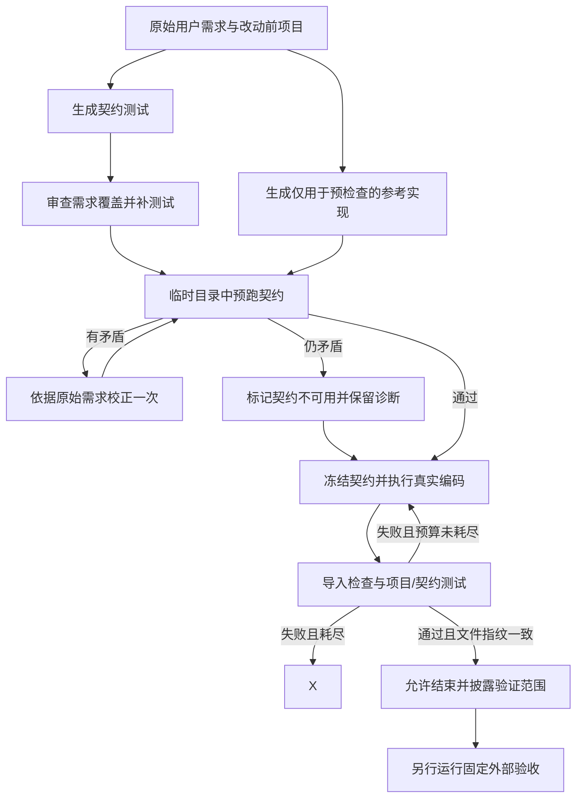

# Ibex 修复记录与面试讲述

日期：2026-11-14（北京时间）。本文记录实际问题、方案、验证与限制，完成过程中持续更新。Windows、Linux 机制回归各 137 项通过；模型任务质量以末尾完整实测结果为准。

## 背景：服务可运行不等于开发任务成功

上一轮 Windows/Linux 服务回归各 117 项通过，真实飞书接入、队列、Worker、Outbox 也通过。但固定开发任务集 6 题 × 2 次只完成 1/12（8.3%）：一项边界断言失败就算整次失败。原始数据保留在 `eval/results/2026-11-13-objective-v1.json`。

## 修复顺序与方案

| 顺序 | 问题及证据 | 原因 | 本轮解决方案 | 验证状态 |
| --- | --- | --- | --- | --- |
| 1 | 非有限金额触发 InvalidOperation；bool 被当作整数；失败后状态要求被遗漏 | 模型自建测试偏向正常样例，没有逐项验收输入契约 | 修改前从原始需求单独生成契约测试；与实现分开生成；测试保留在控制端，每次验证重新注入沙箱；失败不能直接报告完成 | 已实现，机制回归通过 |
| 2 | `confloat(finite=True)` 导致 Pydantic 模块导入失败 | 按记忆调用 API，没有核对安装版本 | 提供沙箱内依赖签名检查工具；验证时导入改动模块，再跑契约和项目测试 | 已实现，安装版本签名与导入失败测试通过 |
| 3 | edit_file 重复失败、三次图上限、一次 300 秒超时 | 精确匹配编辑缺乏恢复流程，测试失败没有约束最终结果 | 重复相同失败调用受限；提供完整文件读取及 SHA256 条件替换；结束前验证指纹，修改后旧测试结果失效；修复轮次与工具次数有上限 | 已实现，旧哈希拒绝、失败阻断和真实图路由测试通过 |
| 4 | 超时/图异常样本没有完整诊断产物 | 在成功返回后才取代码，异常直接释放沙箱 | 异常释放前尽力保存目标文件、契约和有界工具轨迹；保持原错误为主错误 | 已实现，异常先采集后清理测试通过 |
| 5 | 第一轮修复试跑仍然达到图上限，轨迹显示反复 `ModuleNotFoundError: app` | pytest 控制台入口未保证项目进入 sys.path；命令退出码只出现在 ToolMessage 文本中，审计错误地计为成功 | 沙箱 execute 明确设置 PYTHONPATH；识别命令非零退出标记为失败；相同失败调用受限，实际修改后允许重新测试 | 已定位并修复，待真实复测 |
| 6 | 第二次试跑内部测试通过，但外部非法输入断言仍失败 | 内部测试覆盖了负数、Infinity，却遗漏无法解析的数值字符串；测试作者与实现模型共享盲点 | 冻结契约前追加独立的需求覆盖审查，只允许补测试；明确检查不同非法输入等价类，不用“测了负数”替代“测了非数值字符串” | 已定位并修复，待真实复测 |
| 7 | 第三次试跑内部舍入测试把 `0.0049 + 0.0050 + 0.0051` 按两位 ROUND_HALF_UP 错写成 0.01（实际 0.02） | 生成测试本身也会幻觉，错误门禁会诱导实现偏离需求 | 在候选实现生成前，用只看原始需求的参考实现隔离预跑契约；最多一次矛盾校正，不允许减少测试数量；仍矛盾则阻塞。参考代码不注入候选工作区 | 已定位并修复，待真实复测 |
| 8 | 复测中参考源码 JSON 解析失败 | 实际返回把 Python 源码中的换行直接放进 JSON 字符串，标准 strict JSON 解码拒绝 | 专用解码器仅放宽字符串控制字符限制，继续要求 JSON 对象、路径白名单、类型与 AST 检查；不使用 eval；保留旧轮结果，修正后另开新轮 | 已复现并修复，回归及重跑验证中 |
| 9 | 强制预检查阻塞了多个尚未编码的任务 | 生成参考实现不是真值，要求两份不可靠模型输出完全一致会降低可用性 | 撤回“争议契约阻塞整任务”：未通过预检查的契约不进入强制断言，记录 project_only；项目测试仍必须通过，最终回复必须说明完整需求未验证 | 已实现，范围披露和项目失败阻断测试通过 |
| 10 | 多个试次在约 2 秒内 BadRequestError，直接模型探测返回 Arrearage | 模型账号欠费或状态异常，不能归因于代码能力 | 保存允许名单中的账号错误码，停止剩余付费调用，记录 planned_trials 和 incomplete；不保存可能含敏感信息的原始异常文本 | 已实现，用户恢复账号后最小请求成功，已重新复测 |

## 面试回答框架

“我把验证分成服务正确性和任务质量两层。服务回归通过后，我用固定任务及独立验收发现只有 1/12 完成，问题集中在边界校验、依赖兼容和工具循环。因此没有先堆更多 Agent 角色，而是补需求到测试的闭环：从原始需求独立起草内部契约测试、检查真实依赖签名、修改后强制验证，并限制无效循环。最后保留原基线，用相同外部验收再跑，并加入新题检查泛化。”

这里的“独立”指测试生成步骤不看待评实现，不代表使用不同厂商模型。内部测试可能和实现共享模型偏差，不能代替外部验收。被争议测试误拦后，我根据实测调整了设计，而不是不断增加判断层。

## 核心流程（可画在面试白板上）

参考实现和契约预检查在编码开始前完成，候选 Agent 不会拿到参考源码；临时目录结束即删除。只有预检查通过的契约作为额外断言；未通过时仍运行项目测试，并明确报告 `project_only`，不能冒充完整需求验证。外部验收模块不注入工作区，只在 Agent 执行结束后运行。

## 常见追问与回答要点

**为什么不用一句更长的提示词解决？**

提示词负责告诉模型怎么做，机制负责检查是否做到了。这里增加了实际退出码判断、内容指纹、重复失败预算和图路由。即使模型回复“完成”，失败的测试仍会触发纠正轮次。提示词和机制各自有作用。

**如何发现循环的具体原因？**

在异常释放沙箱前保存代码与工具轨迹。第一次试跑显示 pytest 找不到 `app`，模型误改 conftest 并重试；这将模糊的“模型不稳定”定位成导入路径与工具错误识别问题。随后明确 PYTHONPATH，并把命令非零退出标记为失败。

**SHA256 用来做什么？**

用于检查文件版本，不是权限或安全凭证。Agent 先读取文件，替换时提交读取版本的哈希；内容已经变了就拒绝覆盖。验证结束也保存 app/tests 下 Python 文件指纹，继续修改后必须重新测试。并发互斥仍由现有工作区锁负责。

**测试也错了怎么办？**

实际遇到过：生成测试把 0.015 按两位 ROUND_HALF_UP 错写为 0.01，正确应为 0.02。参考预检查能发现部分矛盾，但参考实现也可能错。我先试过严格阻塞，实测发现过度阻塞；最终改为不采信有争议的生成契约，仍强制执行项目测试，并披露验证范围。没有修改外部评测答案或门槛。参考与测试共享模型，仍可能一起犯错，所以保留外部验收。

**如何避免刷评测分数？**

旧任务定义和外部验收命令保持不变，原始失败基线不覆盖；新增三类不同任务单独统计；所有超时和失败都计入分母。开发试跑不混入正式复测，也不只挑最好一次。

**有什么代价？**

每个编码任务新增契约起草、覆盖审查、参考生成等模型调用，矛盾校正还会增加一次调用；因此成本和延迟可能上升。本轮记录内部调用 usage，不将它们混同于原有主 Agent token 计数。当前方案先验证正确性收益，没有宣称成本降低。

这些额外调用的 usage 目前主要保存在评测轨迹中，原主 Agent token 累计和成本看板不能当作它们的完整账单统计。失败在契约发布前时，部分阶段 usage 可能缺失，不能补零推算成本。

## 必须诚实说明的边界

- 不能说“加了测试门禁就保证代码正确”。它只能验证已有断言；遗漏需求、错误预期和恶意代码仍需处理。
- 不能把生成的内部契约测试叫作隐藏评测题；固定外部验收不提供给 Agent。
- 不通过放宽门槛、删除失败试次、修改原题或换模型来伪装提升。
- 单次测试通过只能对应当时的文件版本；修改后的旧证据必须失效。
- 标准 Docker 是当前运行环境，未在本轮证明强隔离、高并发或生产 SLA。
- 当前强制验证面向具有命令执行能力的 Python 沙箱；纯文件模式不具备相同执行验收能力。
- 图上限和超时可能先于内部纠正预算触发；有界失败不是保证任务成功。
- 文件指纹只覆盖 app/tests 下 Python 文件；非 Python 资源、进程和外部状态不在当前验证范围。
- `project_only` 表示生成契约不可用，只验证项目测试，不等于“完整需求已满足”。
- 这些验证防止无意遗漏，不是防恶意 Agent 绕过测试的安全隔离机制。

## 最终验证与面试数字

待本轮回归、相同任务集复测和新增任务评测完成后填写。原始失败基线不覆盖。
